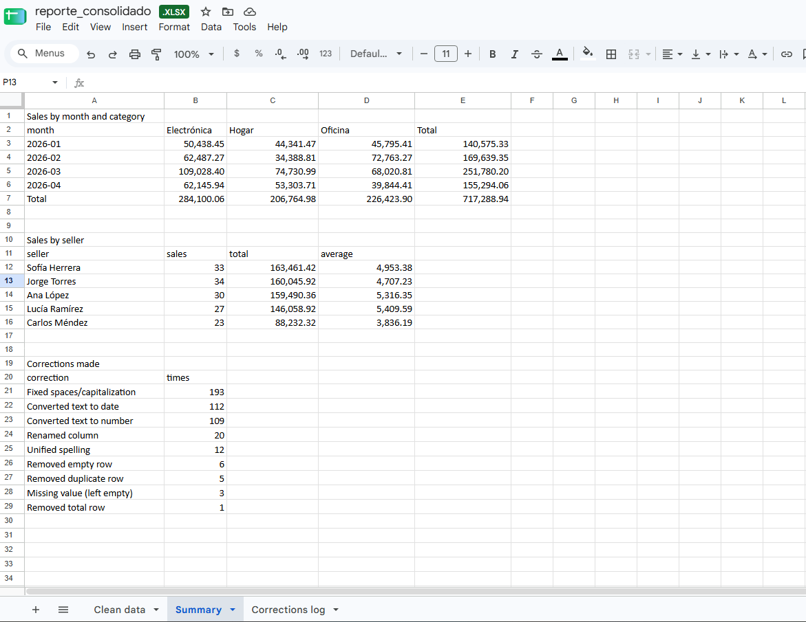
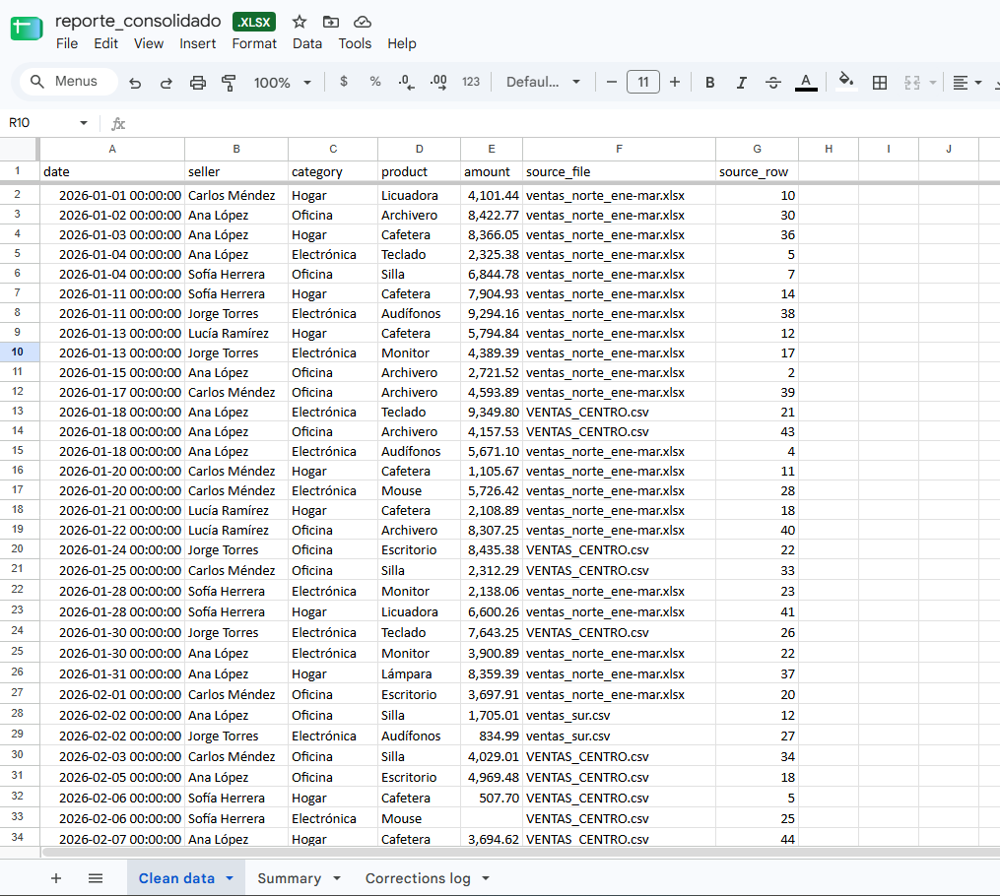
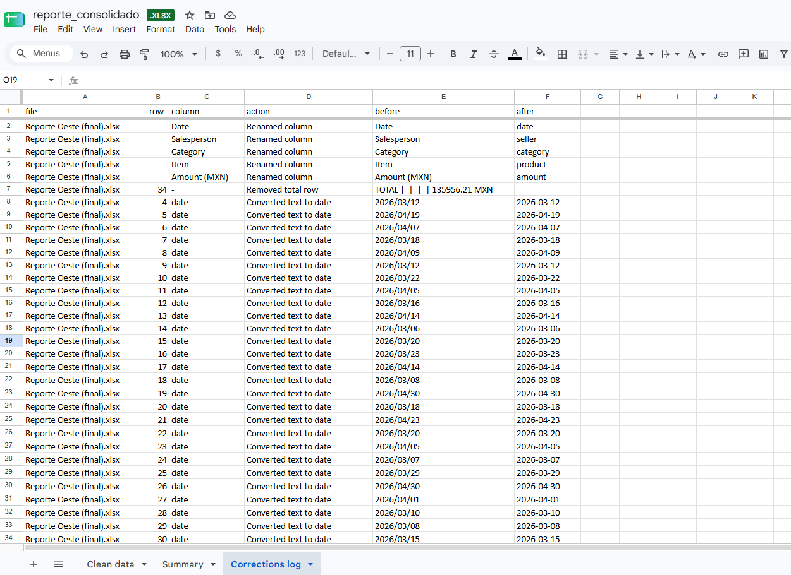

# Excel Report Cleaner & Consolidator

A Python command-line tool that takes **messy Excel and CSV sales reports** from different sources and turns them into **one clean, consolidated Excel report** with a summary and a full log of every correction it made.

One command, a few seconds, no manual copy-paste.

```bash
python clean_reports.py
```

---

## The problem

When a business collects reports from several branches, sellers or systems, every file looks a little different:

- Different column names for the same thing (`Monto`, `IMPORTE`, `total`, `Amount (MXN)`)
- Dates in mixed formats (`08/02/2026`, `2026-02-19`, `2026/03/12`)
- Amounts stored as text (`$1,250.50`, `1.250,50`, `2675.27 MXN`)
- Extra spaces and inconsistent capitalization (`  Ana López `, `ANA LÓPEZ`, `ana lópez`)
- Empty rows, duplicated rows, titles above the table and `TOTAL` rows that get counted twice
- CSVs with `;` instead of `,`, or saved with Windows encoding that breaks accented letters

Cleaning this by hand every week is slow and error-prone. This tool does it automatically and shows you exactly what it changed.

## Before → After

**Before** – four files, four different formats:

| File | Raw row |
|---|---|
| `ventas_sur.csv` | `08/03/2026, jorge torres, Electrónica, Teclado, "$5,191.84"` |
| `VENTAS_CENTRO.csv` | `08/02/2026; JORGE TORRES; OFICINA; ESCRITORIO; 2.754,94` |
| `Reporte Oeste (final).xlsx` | `2026/03/12 \| Lucía Ramírez \| ... \| 2675.27 MXN` (with a title row on top and a TOTAL row at the bottom) |
| `ventas_norte_ene-mar.xlsx` | `"  Ana López "` with blank rows and duplicates in between |

**After** – one table, one format (`Clean data` sheet):

| date | seller | category | product | amount | source_file | source_row |
|---|---|---|---|---|---|---|
| 2026-02-08 | Jorge Torres | Oficina | Escritorio | 2,754.94 | VENTAS_CENTRO.csv | 2 |
| 2026-03-08 | Jorge Torres | Electrónica | Teclado | 5,191.84 | ventas_sur.csv | 3 |

Every clean row keeps its **source file and original row number**, so any value can be traced back and verified.

Result on the included sample data:

```
Reading 4 file(s) from ...\entrada
  OK       Reporte Oeste (final).xlsx
  OK       VENTAS_CENTRO.csv
  OK       ventas_norte_ene-mar.xlsx
  OK       ventas_sur.csv

Clean rows: 150  |  Corrections logged: 461
Rows without amount: 3 (kept, but not counted in totals)
Report saved to: ...\salida\reporte_consolidado.xlsx
```

## The output report

`salida/reporte_consolidado.xlsx` contains three sheets:

| Sheet | Content |
|---|---|
| **Clean data** | All rows unified with standard columns: `date, seller, category, product, amount, source_file, source_row` |
| **Summary** | Sales by month × category (with totals), sales by seller (count, total, average) and number of corrections by type |
| **Corrections log** | Every change, one per line: file, row, column, action, value before, value after |

**Summary**



**Clean data**



**Corrections log**



## Features

- Reads **`.xlsx` and `.csv`** files from a folder
- Detects the CSV **separator** (`,` or `;`) and **encoding** (UTF-8 or Windows) automatically
- Finds the **real header row** even when there are titles above the table
- Maps different column names to a standard set via a simple **synonyms dictionary**
- Cleans text (spaces, capitalization) and **unifies spelling variants** (`Electronica` → `Electrónica`)
- Converts **amounts** in US (`1,250.50`) or Latin American/European (`1.250,50`) format, with currency symbols or text
- Converts **dates** in several formats (day-first)
- Removes **empty rows, `TOTAL` rows and duplicates**
- **Never invents data**: missing or unreadable values are left empty and reported
- A broken file is **skipped with a clear message**; the rest are still processed
- Clear error if the output file is open in Excel

## Installation

Requires **Python 3.10+**.

```bash
git clone https://github.com/<your-user>/excel-report-cleaner.git
cd excel-report-cleaner
python -m venv .venv
```

Activate the virtual environment:

```bash
# Windows (PowerShell)
.venv\Scripts\Activate.ps1
# macOS / Linux
source .venv/bin/activate
```

> On Windows, PowerShell may ask whether to run a script published by *Python Software Foundation*. That is the official Python activation script; choose **[R] Run once** / **[Z] Ejecutar una vez**.

Install dependencies:

```bash
pip install -r requirements.txt
```

## Usage

1. Put your Excel/CSV files in the `entrada/` folder.
2. Run:

   ```bash
   python clean_reports.py
   ```

3. Open `salida/reporte_consolidado.xlsx`.

Custom folders:

```bash
python clean_reports.py --input path/to/reports --output path/to/results
```

Want to try it with fake data first? Generate the four messy sample files:

```bash
python generate_sample_data.py
```

### Adapting to new column names

If your files use a column name the tool does not know yet (for example `Importe total`), add it to `COLUMN_SYNONYMS` at the top of `clean_reports.py`:

```python
"amount": ["monto", "total", "importe", "amount", "amount (mxn)", "importe total"],
```

No other code changes are needed.

## Tests

```bash
python -m pytest
```

29 automated tests cover the amount and date parsers, column mapping, header detection, and full end-to-end runs, including a cross-check that the cleaned amounts of a file add up to that file's own `TOTAL` row.

## Known limitations

- Dates are interpreted **day-first** (`05/03/2026` = 5 March). US month-first files would need a setting change.
- An amount like `1.250` (a single dot followed by 3 digits) is read as `1.25`.
- Title-casing turns `Ana de la Cruz` into `Ana De La Cruz`.
- Older `.xls` files are not supported (save them as `.xlsx`).

## Project structure

```
excel-report-cleaner/
├── clean_reports.py          # main script
├── generate_sample_data.py   # creates messy sample files for testing
├── entrada/                  # input files (sample data included)
├── docs/                     # screenshots for this README
├── salida/                   # generated report (created on first run)
├── tests/                    # automated tests (pytest)
├── requirements.txt
└── pytest.ini
```

## Tech stack

- **Python 3**
- **pandas** – reading, cleaning, consolidating and summarizing tables
- **openpyxl** – writing the Excel report and formatting it
- **pytest** – automated tests
- Standard library: `pathlib`, `argparse`, `re`, `unicodedata`, `collections`
